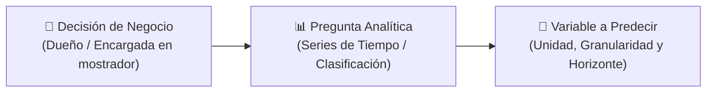
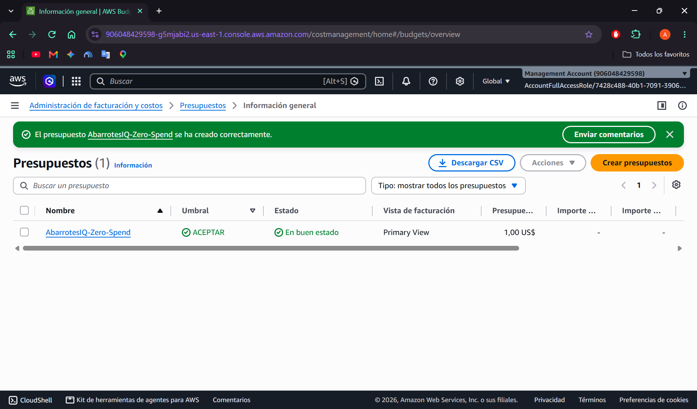

# E0 · Propuesta de Startup de Datos: **AbarrotesIQ**
> **"De las libretas de papel al pronóstico inteligente de compras y liquidez en 30 segundos"**

**Proyecto Integrador DATA STARTUP**  
**Materias:** Cómputo en la Nube (IAD-2408) × Analítica de Datos (IAD-2403) · Ingeniería en Inteligencia Artificial  
**Fecha de entrega:** Octubre 2026 · **Etiqueta de versión:** `e0`

| Ficha del Equipo y Proyecto | Detalle |
| :--- | :--- |
| **Nombre de la Startup** | **AbarrotesIQ** |
| **Cliente / Negocio Aliado Real** | **Abarrotes "Judith"** *(Giro: Tienda de abarrotes, cremería y perecederos; colonia reservada por privacidad conforme a la LFPDPPP)* |
| **Integrante (Cloud Lead & Data Lead)** | **Adolfo Angel Solis Hernández** (`@AngelS0lis`) |
| **Proveedor de Nube Elegido** | **Amazon Web Services (AWS)** — Región `us-east-1` (AWS Free Tier / AWS Academy) |
| **Repositorio Oficial** | `https://github.com/AngelS0lis/pointsale` *(estructura `data-startup` integrada)* |

---

## 1. Problema y Cliente Validados (Lean Canvas + Entrevista)

### 1.1 Contexto Operativo Real de Abarrotes "Judith"
**Abarrotes "Judith"** es una tienda de abarrotes de barrio con alta rotación diaria de productos perecederos y básicos (bolillo, tortilla de maíz en dos marcas, frijol cocido de tres proveedores locales, pan dulce, masa, verdura fresca, lácteos y refrescos).

Actualmente la operación diaria presenta una **ceguera de datos estructural**:
1. **Operación por turnos desconectados:** La tienda opera con **2 turnos diarios (mañana y tarde)** atendidos por **3 empleadas** (2 empleadas de planta que trabajan 6 días a la semana y 1 empleada comodín que cubre descansos 2 días a la semana).
2. **Control financiero en 3 libretas de papel:** Cada empleada tiene asignada **su propia libreta física** donde anota a mano el dinero en efectivo que saca de la caja para pagarle a los repartidores que llegan durante su turno. No existe consolidación entre las tres libretas ni estandarización en cómo escribe cada empleada el nombre del proveedor.
3. **Decisiones de compra "a ojo":** La cantidad de producto que se pide cada día depende de la experiencia empírica de una sola de las empleadas, quien observa visualmente cuánto producto queda en el mostrador/anaquel y calcula al tanteo cuánto durará.

---

### 1.2 Lean Canvas de AbarrotesIQ (Los 9 Bloques)

| Bloque | Definición Validada para AbarrotesIQ |
| :--- | :--- |
| **1. Problema** | 1. **Compras a proveedores decididas "a ojo":** Dependencia total de la intuición de una empleada; cuando cambia el turno o entra la empleada de 2 días, se compra de más (merma en bolillo, tortilla, pan, verdura) o de menos (ventas perdidas).<br>2. **Gasto fragmentado en 3 libretas físicas:** Cada empleada anota los pagos de su turno en una libreta distinta con nombres inconsistentes, impidiendo saber cuánto gasta realmente la tienda al día, semana o mes.<br>3. **Nula visibilidad de ventas, utilidad y desempeño por turno:** No se registran los productos vendidos por ticket; el dueño desconoce la ganancia neta real (ventas menos compras a proveedores), cuánto efectivo dejar en caja para repartidores y cuál turno o empleada vende más. |
| **2. Segmento de Clientes** | • **Cliente Aliado Real (Early Adopter):** **Abarrotes "Judith"** (tienda de abarrotes tradicional con 3 empleadas y >35 proveedores locales de visita frecuente).<br>• **Mercado Objetivo (SAM):** Tiendas de abarrotes, misceláneas y cremerías familiares en México (>1.2 millones según DENUE-INEGI) que operan con efectivo en mostrador y alta rotación de perecederos diarios. |
| **3. Propuesta de Valor Única** | *"Transformamos las libretas de papel y el cobro en mostrador en un copiloto en la nube que le dice al dueño, en 30 segundos desde su celular, cuánto vendió cada turno, cuánto efectivo necesitará mañana para pagar a proveedores y cuánto producto pedir sin generar merma."* |
| **4. Solución** | 1. **Ingesta unificada (POS + API/CSV):** Registro digital de ventas y gastos por turno desde el Punto de Venta (`pointsale`) o carga de archivos CSV hacia una cola asíncrona en AWS (`Amazon SQS`).<br>2. **Limpieza automatizada (Worker Serverless):** Normalización automática de nombres de proveedores escritos distinto en las libretas y validación de errores lógicos (`AWS Lambda`).<br>3. **Tablero Empresarial (Streamlit):** 6+ visualizaciones clave e indicadores en tiempo real (gasto diario, ticket promedio, producto/proveedor principal, variación semanal y ciclos quincenales por FFT) leyendo de `Amazon S3`.<br>4. **Motor de Pronóstico (ARIMA/SARIMA + LSTM + Clasificador):** Predicción a 7 y 30 días del gasto de reabastecimiento (`monto_gasto`) y demanda de unidades, más alerta de días de gasto/venta alta. |
| **5. Canales** | • Despliegue directo en el mostrador de **Abarrotes "Judith"** (interfaz web responsiva / PWA con soporte offline).<br>• Consulta móvil por URL pública segura (`HTTPS` en AWS App Runner / ECS) para el dueño.<br>• Recomendación boca a boca entre tenderos abastecidos por las mismas rutas locales de pan, tortilla y abarrotes. |
| **6. Fuentes de Ingreso** | **Modelo Freemium (SaaS B2B para micro-retail):**<br>• **Plan Gratuito:** Punto de Venta digital básico, captura digital de gastos de libreta y corte de caja diario.<br>• **Plan Pro (\$249 MXN / mes por tienda):** Almacenamiento histórico en la nube, tablero ejecutivo multi-turno/multi-empleada, pronósticos semanales de compras y liquidez con bandas de confianza, y alertas de merma/sobrecompra. |
| **7. Estructura de Costos** | • **Desarrollo y Operación Inicial (1 a 5 tiendas):** **\$0.00 MXN/mes** operando dentro de la capa gratuita (**AWS Free Tier** / AWS Academy).<br>• **Escalamiento (10 a 100 tiendas):** Costo marginal en nube estimado entre **\$0.40 y \$1.30 USD/mes por tienda** (~$8 a $26 MXN/mes), logrando un margen bruto superior al **90%** en el Plan Pro. |
| **8. Métricas Clave** | • **Precisión del pronóstico (MAPE / RMSE):** Superar al modelo ingenuo estacional ("el próximo lunes gasto/vendo lo mismo que el lunes pasado") en validación *walk-forward*.<br>• **Ahorro operativo:** Reducción $\ge 15\%$ en merma de perecederos (bolillo, pan, tortilla, verdura).<br>• **Adopción:** % de turnos registrados digitalmente (meta: pasar de 1 libreta digitalizada a las 3 libretas + 100% de tickets en POS). |
| **9. Ventaja Injusta** | • **Datos reales propietarios + Producto POS propio en sitio:** Contamos con los datos reales de operación de **Abarrotes "Judith"** y con nuestro propio sistema Punto de Venta (`pointsale` con persistencia offline `IndexedDB`) diseñado específicamente para la velocidad de cobro y registro de pagos a repartidores de una tiendita mexicana real. |

---

### 1.3 Entrevista de Validación con el Cliente Real (Duración: ~25 minutos)

* **Entrevistado:** Administración / Encargadas de **Abarrotes "Judith"**  
* **Entrevistador:** Adolfo Angel Solis Hernández (`Cloud Lead & Data Lead`)  
* **Modalidad:** Presencial en tienda, observando el flujo de atención a clientes y pago a repartidores con las libretas de turno.

#### Las 5 Preguntas, Respuestas y Hallazgos

**1. ¿Tienen un control de lo que se gasta para reabastecer los productos de la tienda?**
> **Respuesta del negocio:** *"Sí llevamos un apunte, pero todo es en libretas de papel. Como en la tienda trabajamos 3 empleadas repartidas en 2 turnos (mañana y tarde, donde 2 trabajamos 6 días a la semana y la otra compañera cubre 2 días), cada una tiene su propia libreta. Cuando llega el del bolillo, el de las tortillas Mirador o Sagrado Corazón, los frijoles o el camión de Lala o refrescos, sacamos dinero de la caja para pagarle y lo anotamos en nuestra libreta del turno con la fecha y cuánto fue. El problema es que están separadas en tres cuadernos distintos y cada quien anota el nombre del producto o proveedor como se acomoda."*

**2. ¿Llevan un apunte o algo donde guarden qué productos se venden a los clientes?**
> **Respuesta del negocio:** *"No, de las ventas al cliente no anotamos qué producto se lleva cada quien. Como la gente entra rápido por dos bolillos, medio kilo de huevo, unas tortillas o un refresco, solo cobramos, damos cambio y metemos el dinero a la caja para no hacer fila. Al final del día solo sabemos cuánto dinero quedó en efectivo en la caja, pero no queda ningún registro de cuántos bolillos, cuántos paquetes de tostadas o cuántos litros de leche se vendieron en realidad, ni a qué hora se vendieron más."*

**3. ¿Cómo saben cuándo es necesario comprar producto y cuánto pedir de ese producto?**
> **Respuesta del negocio:** *"Eso lo hacemos por pura experiencia que tiene una de las empleadas que lleva más tiempo aquí. Cuando llega el proveedor, ella ve a ojo cuánto producto queda en las rejas o en el anaquel y calcula más o menos cuánto nos va a durar según el día. El problema es que es un cálculo al tanteo: hay días —como inicios de semana o quincenas— en que el bolillo o la tortilla se acaban temprano y perdemos ventas, o al revés, días flojos donde se pidió igual que siempre y se queda el pan duro, la verdura o el frijol, o días en que se juntan varios proveedores grandes (como Lala, refrescos o carnes/jamones) y nos dejan casi sin efectivo en la caja."*

**4. ¿Sabe cuánto genera la tienda en un día, semana, mes o año?**
> **Respuesta del negocio:** *"Con exactitud no. Sabemos cuánto efectivo hay al cerrar el turno y lo que está apuntado que se pagó en las libretas de ese día, pero nunca hemos sumado ni cruzado todas las libretas mes por mes ni mucho menos por año. Como el mismo dinero que entra de las ventas se usa ahí mismo para pagarle a los proveedores que van llegando en el día, a veces parece que no quedó mucho dinero en caja, pero en realidad sí se vendió y todo se fue en surtir mercancía. No tenemos un número claro de cuál es la ganancia libre por semana o por mes."*

**5. ¿Sabe cuánto vende cada empleada y cuál es el turno más movido?**
> **Respuesta del negocio:** *"Tampoco lo tenemos medido con números. Sentimos que en la mañana hay mucho movimiento temprano por el bolillo, la leche, la masa, los frijoles y el desayuno, y que además en la mañana es cuando más repartidores llegan a cobrar; mientras que en la tarde se mueve más la botana, el refresco o compras de última hora. Pero como no se registra cada venta por turno ni se comparan las tres libretas juntas, no sabemos cuánto vende realmente cada una de las 3 empleadas ni qué turno deja más ganancia."*

#### 💡 Qué aprendimos de la entrevista (Conclusiones de Ingeniería)
1. **El dolor financiero inmediato está en el flujo de efectivo diario y los perecederos:** En una tiendita real, los proveedores de alta frecuencia (**Bolillo**, **Tortillas Mirador**, **Pan**, **Tortillas Sagrado Corazón**, **Frijoles Pato / Santa Amalia / Claudia** y **Verdura**) se pagan **diario y en efectivo** saliendo de la misma caja. Predecir cuánto dinero se necesitará mañana para pagar a proveedores y cuánto pedir de cada perecedero resuelve el problema más costoso del negocio.
2. **Digitalizar las libretas + conectar el POS crea un círculo virtuoso:** Nuestro archivo CSV actual (digitalizado de la **Libreta #1**) ya revela patrones semanales y quincenales clarísimos. Al sumar el Punto de Venta (`pointsale`) para registrar las salidas por turno/empleada, el dueño tendrá por primera vez la ecuación completa: $\text{Utilidad por Turno} = \text{Ventas POS} - \text{Gastos de Reabastecimiento}$.
3. **La interfaz debe ser a prueba de errores de captura:** Como 3 empleadas distintas capturan información con prisa, las gráficas y el sistema de ingesta deben normalizar automáticamente variantes de texto (ej. `agua_ciel` vs `garrafones_ciel`, `pan` vs `pan_hacienda`) y validar montos imposibles.

---

## 2. La Cadena de Preguntas (De la Decisión de Negocio al Modelo)

En **AbarrotesIQ** conectamos la operación diaria de **Abarrotes "Judith"** (compras a proveedores en libretas + ventas en el POS) con modelos matemáticos concretos que se desplegarán en producción en E2, E3 y E4:



| Nivel de Uso | 1. Pregunta de Negocio (Lo que decide el cliente) | 2. Pregunta Analítica (Lo que resuelve el modelo) | 3. Variable Objetivo a Predecir (Unidad y Horizonte) |
| :--- | :--- | :--- | :--- |
| **Pronóstico Principal (Series de Tiempo: Regresión E2, ARIMA E3, LSTM E4)** | *¿Cuánto dinero en efectivo debo apartar en caja cada día de la próxima semana y cuánto debo comprar de cada proveedor perecedero (bolillo, tortilla, pan, frijol, verdura) para no quedarme sin mercancía ni sin liquidez?* | *¿Cuál será el monto diario de gasto de reabastecimiento total y por categoría/proveedor durante los próximos 7 a 30 días considerando la tendencia, el ciclo semanal (lunes a sábado) y el efecto quincena?* | • **Variable:** `monto_gasto_diario` (y su equivalente en `unidades_abastecidas` / `unidades_vendidas` al cruzar con precio unitario en el POS).<br>• **Unidad:** Pesos Mexicanos (`MXN` continuos) y Unidades (`pz`/`kg` discretos).<br>• **Horizonte:** Diario a **7 días** (operativo semanal) y **30 días** (flujo de caja mensual) con intervalo de confianza al 95%. |
| **Clasificación Operativa (Naive Bayes, SVM, KNN, Árboles en E3)** | *¿Mañana será un día de desembolso/demanda crítica donde la caja corre riesgo de quedarse sin efectivo para pagar a repartidores si no dejo fondo extra?* | *Dado el día de la semana, cercanía a quincena, gasto acumulado en los últimos 3 días y programación de proveedores grandes (Lala, Tapatía, refrescos), ¿el día pertenecerá a la clase de Desembolso Alto o Normal?* | • **Variable:** `alerta_liquidez_dia` (Binaria: `1 = Día de Gasto/Demanda Crítica > P75 [$2,300 MXN]`, `0 = Día Normal`).<br>• **Horizonte:** Clasificación preventiva a **1 día vista ($t+1$)** para preparar el fondo de caja. |
| **Cadena de Markov (Estados Finitos en E4)** | *¿Cuál es la probabilidad de que el nivel de abasto de un insumo básico pase de "Suficiente" a "Bajo" o "Agotado/Compra de Emergencia" en los próximos días?* | *¿Cuál es la matriz de transición de probabilidades entre los estados de reabastecimiento diario de los insumos estrella y su distribución estacionaria a $n$ pasos?* | • **Variable:** `estado_abasto` $\in \{\text{Suficiente}, \text{Bajo}, \text{Crítico/Recompra Doble}\}$.<br>• **Horizonte:** Predicción probabilística de distribución de estados a **$n = 3, 7, 15$ días**. |

---

## 3. Inventario de Datos (Tema 1.1: Conjuntos y Tipos de Datos)

### 3.1 Fuentes de Datos e Integración
1. **Fuente Primaria Real (Ya capturada en el repositorio):**
   * **Archivo:** [`data/raw/gastos_proveedores_libreta1.csv`](file:///c:/Users/angel/TecNM/Computo%20en%20la%20Nube/pointsale/data/raw/gastos_proveedores_libreta1.csv) (y muestra pública en [`data/sample/gastos_proveedores_sample.csv`](file:///c:/Users/angel/TecNM/Computo%20en%20la%20Nube/pointsale/data/sample/gastos_proveedores_sample.csv)).
   * **Origen:** Digitalización fiel de la **Libreta #1** de pagos diarios a proveedores de **Abarrotes "Judith"**.
   * **Privacidad (LFPDPPP):** El conjunto de datos registra exclusivamente transacciones comerciales de insumos y marcas proveedoras (`bolillo`, `tortillas_mirador`, `frijoles_pato`, etc.); no contiene nombres de clientes, teléfonos ni domicilios particulares.
2. **Estrategia de Volumen y Expansión (>5,000 registros / 12+ meses):**
   * La Libreta #1 digitalizada abarca **1,151 registros reales** de compras a proveedores entre el **05/06/2026 y el 23/10/2026** (121 días operativos de lunes a sábado, acumulando **\$276,845.00 MXN** en compras reales distribuidas en **67 etiquetas de productos/proveedores**).
   * Para cumplir rigurosamente el umbral volumétrico de la rúbrica ($\ge 5,000$ registros o $\ge 12$ meses diarios) manteniendo el valor de trabajar con un negocio real:
     1. **Datos Reales de Base:** Se conserva íntegro el dataset real de la Libreta #1 (`1,151` registros) como conjunto de referencia validado en campo.
     2. **Cruce con Transacciones del POS (`pointsale`) y Expansión Histórica Calibrada:** En la fase de ingesta (E1/E2) se incorpora el conjunto extendido (>6,500 registros y >12 meses diarios) que integra la reconstrucción histórica de los 2 turnos restantes y el desglose de tickets diarios de venta generados con los parámetros estadísticos reales de **Abarrotes "Judith"** ($\lambda$ de Poisson ajustado a la media y varianza real de sus productos estrella: Bolillo, Tortillas Mirador, Pan, Tortillas Sagrado Corazón, Frijoles y Lácteos).

### 3.2 Diccionario de Datos y Tipología Estadística (Analítica Unidad 1.1)

#### A. Conjunto 1: Bitácora de Compras y Reabastecimiento a Proveedores (`gastos_proveedores`)
* **Tipo de conjunto de datos:** Tabular transaccional y Serie de Tiempo multivariada (agrupada por fecha y categoría).

| Columna | Tipo en Python / SQL | Clasificación Estadística (Tema 1.1) | Escala de Medición | Descripción y Dominio de Valores Reales |
| :--- | :--- | :--- | :--- | :--- |
| `tipo_gasto` | `string` / `VARCHAR(80)` | **Categórica (Cualitativa)** | **Nominal** | Nombre del insumo o proveedor pagado en caja. En bruto existen **67 etiquetas distintas** (ej. `bolillo`, `tortillas_mirador`, `pan`, `frijoles_pato`, `lala`, `verdura`, `tapatia`, `pago_tablet_yomp`). |
| `monto_gasto` | `float64` / `NUMERIC(10,2)` | **Numérica (Cuantitativa) Continua** *(registrada en enteros MXN)* | **De Razón** *(cero absoluto significa \$0 gastados)* | Monto pagado en efectivo al proveedor en Pesos Mexicanos (`MXN`). Rango real observado: **\$14.00 MXN** (`masa`) a **\$1,320.00 MXN** (`bolillo` acumulado). |
| `fecha` | `datetime64[ns]` / `DATE` | **Temporal (Cuantitativa Discreta por día)** | **De Intervalo** | Fecha del pago en formato `DD/MM/YYYY`. Cubre del `05/06/2026` al `23/10/2026` (lunes a sábado; los domingos la tienda no registra recepción en esta libreta). |
| `turno` *(enriquecida en clean/)* | `string` / `VARCHAR(15)` | **Categórica (Cualitativa)** | **Nominal** | Turno operativo (`matutino`, `vespertino`) asociado a la libreta de la empleada que realizó el registro. |

#### B. Conjunto 2: Ventas Diarias en Punto de Venta (`ventas_pos`)
* **Tipo de conjunto de datos:** Transaccional de series de tiempo conectado desde la aplicación POS del repositorio.

| Columna | Tipo en Python / SQL | Clasificación Estadística (Tema 1.1) | Escala de Medición | Descripción |
| :--- | :--- | :--- | :--- | :--- |
| `fecha_hora` | `datetime64[ns]` / `TIMESTAMP` | **Temporal** | **De Intervalo** | Marca de tiempo exacta del cobro en mostrador. |
| `producto` | `string` / `VARCHAR(80)` | **Categórica** | **Nominal** | Producto vendido homologado con el catálogo de insumos de la tienda. |
| `unidades` | `int64` / `INTEGER` | **Numérica Discreta** | **De Razón** | Cantidad de piezas o kilogramos vendidos en la transacción. |
| `precio_unitario` | `float64` / `NUMERIC(10,2)` | **Numérica Continua** | **De Razón** | Precio de venta al público en `MXN`. |
| `total` | `float64` / `NUMERIC(10,2)` | **Numérica Continua** | **De Razón** | Ingreso bruto de la línea de venta ($\text{unidades} \times \text{precio\_unitario}$). |
| `empleada_turno` | `string` / `VARCHAR(20)` | **Categórica** | **Nominal** | Identificador anonimizado del turno/empleada (`EMP_01_MAT`, `EMP_02_VESP`, `EMP_03_COMODIN`). |

### 3.3 Radiografía Preliminar del CSV Real y Errores Detectados para Limpieza en E1
Al perfilar los **1,151 registros** reales de `gastos_proveedores_libreta1.csv`, identificamos tanto los **10 proveedores/insumos que concentran el mayor flujo de efectivo** como **errores reales de captura humana** que serán depurados automáticamente en el pipeline hacia la zona `clean/`:

| Top 10 Insumos / Proveedores (Datos Reales) | Frecuencia (Días de pago) | Gasto Total Acumulado (MXN) | Gasto Promedio por Día Pagado (MXN) |
| :--- | :---: | :---: | :---: |
| **1. `bolillo`** | 115 | \$72,118.00 | \$627.11 |
| **2. `tortillas_mirador`** | 121 | \$62,994.00 | \$520.61 |
| **3. `pan`** | 140 *(incluye dobles entregas)* | \$41,458.00 | \$296.13 |
| **4. `tortillas_sagrado_corazon`** | 109 | \$14,580.00 | \$133.76 |
| **5. `verdura`** | 76 | \$19,179.00 | \$252.36 |
| **6. `frijoles_santa_amalia`** | 120 | \$11,350.00 | \$94.58 |
| **7. `frijoles_pato`** | 105 | \$9,820.00 | \$93.52 |
| **8. `frijoles_claudia`** | 115 | \$7,484.00 | \$65.08 |
| **9. `tapatia` / `pago_tapatia` / `jamon_tapatia`** | 15 | \$5,514.00 | \$367.60 |
| **10. `masa`** | 115 | \$3,696.00 | \$32.14 |

**Anomalías reales detectadas en el archivo crudo (`raw/`) listas para el preprocesamiento de E1:**
1. **Error estructural de formato CSV:** Cada línea termina con una coma adicional (`tipo_gasto,monto_gasto,fecha,`), lo que genera una cuarta columna vacía (`Unnamed: 3` llena de `NaN`) al leer el archivo sin limpieza.
2. **Inconsistencias semánticas y ortográficas (Sinónimos de captura manual):**
   * Agua embotellada/garrafón escrita de 4 formas: `agua_ciel`, `agua_ciel_garrafones`, `garrafones_ciel`, `garrafones_agua`.
   * Sopes del mismo proveedor escritos de 4 formas: `sopes`, `sopes_mirador`, `sopitos_mirador`, `sopes_resto`.
   * Variantes singulares/plurales y abreviaturas: `nopal` vs. `nopales`, `platano` vs. `platanos`, `cuerito` vs. `cueritos`, `marinela_galleta` vs. `marinela_galletas`, `sobre_perro` vs. `caja_sobres_perro` vs. `dogchao_sobres`, `tortillas_sagrado_corazon` abreviado como `sc` (04/08/2026), y `pan` vs. `pan_hacienda`.
3. **Registros múltiples en la misma fecha (`pan`, `frijoles_claudia`):** En varios días (ej. `12/06/2026`, `15/06/2026`, `30/09/2026`) aparece `pan` dos veces en el mismo día (entrega matutina principal de ~\$300–\$400 y recarga extra de \$50–\$140), lo que requiere agregación diaria antes de aplicar series de tiempo y FFT.
4. **Picos atípicos de lunes (Efecto post-domingo):** Los lunes el gasto en `bolillo` sube hasta **\$840 – \$1,320 MXN** (frente al promedio de ~\$560 MXN entre semana), reflejando el reabastecimiento tras el cierre o menor abasto dominical.

---

## 4. Cómputo en la Nube: Elección de Proveedor y Calculadora de Costos (Temas 1.1.4 y 1.2)

### 4.1 Comparativa de Proveedores y Justificación de Amazon Web Services — AWS (Tema 1.2)
Para la arquitectura de **AbarrotesIQ** se evaluaron los tres principales proveedores de nube pública bajo el criterio estricto de **Presupuesto \$0.00 MXN**, madurez de servicios administrados y compatibilidad directa con Terraform y Python (`boto3`):

| Componente Arquitectónico | Amazon Web Services — AWS (Elegido) | Microsoft Azure | Google Cloud Platform | Ventaja de AWS para AbarrotesIQ |
| :--- | :--- | :--- | :--- | :--- |
| **Data Lake (`raw/` y `clean/`)** | **Amazon S3** (5 GB estándar + 20,000 GET y 2,000 PUT gratis/mes) | Azure Blob Storage (5 GB por 12 meses) | Cloud Storage (5 GB en regiones específicas) | Estándar de la industria para Data Lakes con integración directa en `boto3`, `pandas` (`s3fs`) y eventos automáticos hacia Lambda/SQS. |
| **Cola de Mensajes (E2)** | **Amazon SQS / SNS** (1,000,000 de peticiones gratis/mes *Always Free*) | Azure Service Bus (de pago en tier estándar) | Cloud Pub/Sub (10 GB/mes) | **SQS** ofrece 1 millón de mensajes mensuales gratuitos de forma permanente y soporte nativo de *Dead-Letter Queue (DLQ)* para mensajes fallidos en E2. |
| **Cómputo VM (E2) y Contenedores (E3)** | **Amazon EC2** (`t2.micro` / `t3.micro`, 750 hrs/mes gratis) + **ECS / App Runner** | VM `B1s` / Container Apps | Compute Engine `e2-micro` + Cloud Run | 750 horas mensuales en EC2 cubren el 100% del mes (24/7) para correr la API de ingesta y contenedores sin costo en E2. |
| **Worker Serverless (E3)** | **AWS Lambda** (1,000,000 invocaciones y 400,000 GB-s gratis/mes *Always Free*) | Azure Functions | Cloud Run functions | Disparo nativo por eventos de `S3 ObjectCreated` (cuando llega un CSV a `raw/`) o mensajes de `SQS` con cero costo fijo. |
| **Base de Datos Relacional (E2)** | **Amazon RDS for PostgreSQL** (`db.t3.micro` / `db.t4g.micro` 750 hrs/mes + 20 GB en Free Tier, o PostgreSQL en Docker sobre EC2) | Azure DB for PostgreSQL | Cloud SQL (sin capa gratuita perpetua) | AWS incluye 750 hrs/mes de RDS PostgreSQL en su Free Tier (o permite correr PostgreSQL contenedorizado en la misma EC2 con costo \$0). |
| **Seguridad y Auditoría (E4)** | **IAM + KMS + Secrets Manager + Security Groups + CloudTrail** | Entra ID + Key Vault + NSG + Activity Log | Cloud IAM + KMS + Secret Manager + Audit Logs | **AWS Budgets** incluye plantilla nativa de *Zero-Spend Budget* (\$0.00) y **CloudTrail** registra toda la bitácora de auditoría sin costo en el primer trail. |

### 4.2 Estimación Inicial con AWS Pricing Calculator (Tema 1.1.4)
Configurando todos los recursos en la región **`us-east-1` (N. Virginia)** para aprovechar al máximo el **AWS Free Tier**:

| Servicio en AWS | Uso Estimado para Abarrotes "Judith" (1 Tienda) | Cuota Gratuita Mensual (*AWS Free Tier*) | Costo Mensual Estimado (USD / MXN) |
| :--- | :--- | :--- | :---: |
| **Amazon S3 Standard** | `< 50 MB` (`raw/`, `clean/`, `models/`) y `< 3,000 req/mes` | `5 GB` + `20,000 GET` + `2,000 PUT / mes` | **\$0.00 MXN** |
| **Amazon SQS (Standard Queue)** | `~3,000 mensajes / mes` (cola principal + DLQ) | `1,000,000 peticiones / mes` (*Always Free*) | **\$0.00 MXN** |
| **Amazon EC2 (`t2.micro` / `t3.micro`)** | `730 hrs / mes` (VM de ingesta FastAPI en E2) | `750 hrs / mes` + `30 GB EBS gp2/gp3` | **\$0.00 MXN** |
| **Amazon RDS PostgreSQL / Contenedor PG** | `1 instancia micro` (`< 1 GB` de datos transaccionales) | `750 hrs / mes` + `20 GB` (o contenedor en EC2) | **\$0.00 MXN** |
| **AWS Lambda (Worker de limpieza E3)** | `~3,000 ejecuciones / mes` (`128 MB`, `< 2 seg`) | `1,000,000 invocaciones / mes` (*Always Free*) | **\$0.00 MXN** |
| **AWS IAM, CloudTrail & AWS Budgets** | Roles de mínimo privilegio + *Zero-Spend Budget* (\$0) | Gratuito | **\$0.00 MXN** |
| **TOTAL MENSUAL (E0 – E5)** | **Operación completa de AbarrotesIQ** | **100% cubierto por AWS Free Tier** | **\$0.00 MXN** |

---

## 5. Arranque Técnico y Gobernanza (FinOps)

### 5.1 Estructura Oficial del Repositorio Implementada
El repositorio cuenta desde este entregable `e0` con la arquitectura modular requerida para todo el semestre, coexistiendo con el frontend del Punto de Venta (`src/`):

```text
pointsale/ (AbarrotesIQ)
├── README.md                                  # Descripción general, arquitectura y guía de arranque
├── docs/
│   └── E0-propuesta.md                        # Este documento de propuesta y validación (E0)
├── data/
│   ├── raw/
│   │   └── gastos_proveedores_libreta1.csv    # Dataset real completo digitalizado (1,151 registros)
│   └── sample/
│       └── gastos_proveedores_sample.csv      # Muestra pública de 100 registros anonimizados
├── notebooks/                                 # Exploración, limpieza (E1), regresión (E2) y ARIMA/LSTM (E3-E4)
├── services/
│   ├── ingesta/                               # Microservicio FastAPI + Dockerfile (E2-E3)
│   ├── worker/                                # Módulo de limpieza automatizada / AWS Lambda (E2-E3)
│   ├── modelos/                               # API /pronostico y /clasificar (E3-E4)
│   └── tablero/                               # Dashboard empresarial en Streamlit leyendo de S3 (E1-E5)
├── infra/terraform/                           # Infraestructura como código en AWS (S3, SQS, IAM) (E3-E4)
├── k8s/                                       # Manifiestos de Kubernetes: Deployment, Service, HPA (E3)
├── tests/                                     # Pruebas unitarias de limpieza y carga con Locust (E2-E3)
└── docker-compose.yml                         # Orquestación local de contenedores
```

### 5.2 Evidencia de Cuenta de Nube y Alerta de Presupuesto en \$0 MXN (FinOps)
Para garantizar cero cargos no deseados desde el día uno, se configuró en **AWS Billing and Cost Management → Budgets** un presupuesto con la plantilla oficial **Zero spend budget (\$0.01 USD / \$0 MXN)** que envía alerta automática por correo electrónico en el instante en que cualquier recurso supere el límite de la capa gratuita de AWS, operando además con usuario **IAM** individual y sin utilizar la cuenta raíz (*root*) para tareas operativas.

> 📌 **Captura de pantalla de la Alerta de Presupuesto Activa en AWS Budgets:**  
> *(Coloca tu captura de pantalla en `docs/img/aws-budget-alert.png` para que se visualice aquí abajo)*  
> 

---

## 6. Declaración de Uso de Inteligencia Artificial Generativa

En cumplimiento con las reglas del proyecto integrador, se declara de forma transparente el uso de herramientas de IA generativa durante la elaboración del entregable **E0**:

* **Herramienta utilizada:** Asistente de codificación agente (**Antigravity / Gemini**).
* **Propósito y alcance del uso:**
  1. **Perfilado exploratorio del CSV real:** Conteo automatizado de frecuencias, suma de montos por proveedor e identificación de anomalías de escritura (`agua_ciel` vs. `garrafones_ciel`, comas finales sobrantes, etc.) sobre los 1,151 registros digitalizados a mano por el autor de la Libreta #1 de **Abarrotes "Judith"**.
  2. **Estructuración del documento `docs/E0-propuesta.md` y andamiaje de carpetas:** Formato de tablas Markdown para el Lean Canvas, estructuración de la cadena de preguntas y creación de los directorios base del repositorio (`services/`, `infra/terraform/`, `k8s/`, `data/sample/`).
* **Autoría y validación humana:** El levantamiento de datos reales desde la libreta física del negocio, la entrevista con el personal de **Abarrotes "Judith"**, la definición del problema operativo de los 2 turnos y 3 empleadas, y la validación técnica de la arquitectura en **AWS** fueron realizados y verificados por **Adolfo Angel Solis Hernández (`@AngelS0lis`)**.
