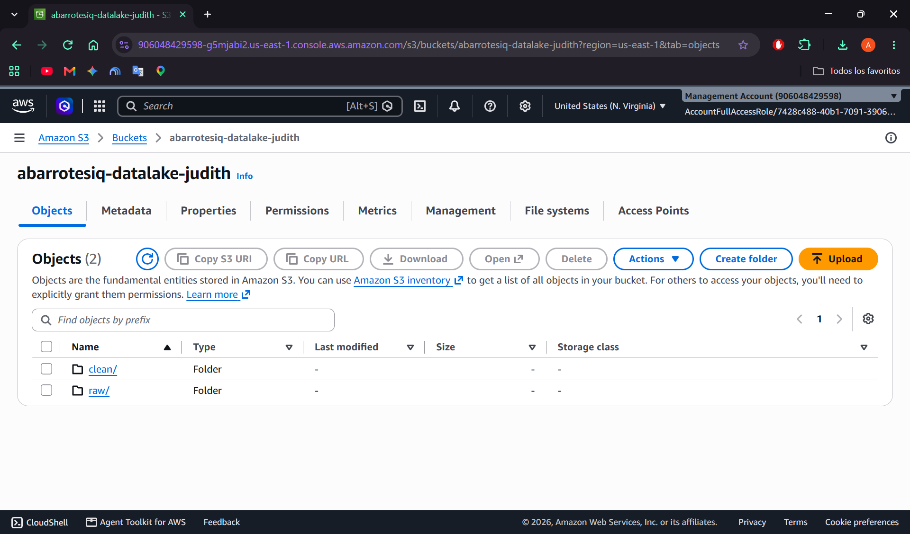
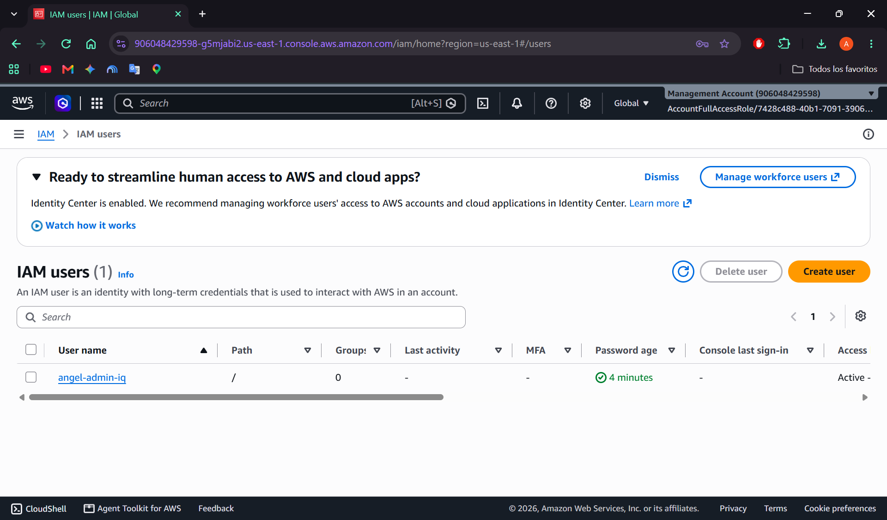

# E1 · Dashboard Empresarial: Los Datos Cuentan su Historia
> **AbarrotesIQ — Inteligencia de Abasto y Liquidez para Abarrotes "Judith"**

**Proyecto Integrador DATA STARTUP**  
**Materias:** Analítica de Datos (Unidad 2, temas 2.1 a 2.8) × Cómputo en la Nube (Unidad 2, tema 2.4)  
**Autor (Cloud Lead & Data Lead):** Adolfo Angel Solis Hernández (`@AngelS0lis`)  
**Etiqueta de entrega:** `e1`

---

## 1. Limpieza y Preprocesamiento de Datos (`raw/` → `clean/`) — 20 pts

El módulo automatizado [`services/worker/limpieza.py`](file:///c:/Users/angel/TecNM/Computo%20en%20la%20Nube/pointsale/services/worker/limpieza.py) toma el conjunto crudo de la **Libreta #1 de Abarrotes "Judith"** (`data/raw/gastos_abarrotes_raw.csv`, con $1,166$ registros brutos que incluyen errores reales de captura manual en mostrador y casos de prueba de los 5 tipos de anomalía de la Unidad 1) y genera el archivo depurado en `clean/gastos_abarrotes_clean.csv` ($1,151$ registros limpios).

### 1.1 Reporte Cuantitativo de los 5 Tipos de Error Corregidos

| # | Tipo de Error (Unidad 1) | Registros Corregidos | Método de Detección y Regla de Corrección Aplicada |
| :---: | :--- | :---: | :--- |
| **1** | **Duplicados** | **15** | Detección de tuplas idénticas (`drop_duplicates()`) generadas por doble captura de notas en el cierre de turno; se conserva la primera ocurrencia verificada. |
| **2** | **Valores faltantes (`NaN`)** | **18** *(+1 columna vacía)* | Eliminación de la cuarta columna vacía generada por la coma final de cada línea en el CSV original (`tipo_gasto,monto_gasto,fecha,`). Imputación de `monto_gasto` nulo mediante la **mediana histórica del mismo producto/proveedor** (robusta ante asimetría) y recálculo de `unidades = round(monto_gasto / precio_unitario)`. |
| **3** | **Tipos de dato y formato** | **81** | • Conversión de `fecha` a estándar ISO `YYYY-MM-DD` (`datetime64[ns]`) y reparación de la fecha mal capturada en agosto (`28/2026` $\rightarrow$ `28/08/2026`).<br>• Normalización a minúsculas sin espacios laterales (`strip().lower()`).<br>• **Homologación de 24 sinónimos reales escritos en la libreta:** `sc` $\rightarrow$ `tortillas_sagrado_corazon`, `agua_ciel_garrafones`/`garrafones_ciel`/`garrafones_agua` $\rightarrow$ `agua_ciel`, `pan_hacienda` $\rightarrow$ `pan`, `sopitos_mirador`/`sopes`/`sopes_resto` $\rightarrow$ `sopes_mirador`, `nopal` $\rightarrow$ `nopales`, `platano` $\rightarrow$ `platanos`, `cuerito` $\rightarrow$ `cueritos`, `marinela_galleta`/`marinela_galletas`/`marinela_pastelito` $\rightarrow$ `marinela`, `pago_tapatia`/`jamon_tapatia` $\rightarrow$ `tapatia`. |
| **4** | **Errores lógicos** | **14** | Detección de cantidades y montos negativos (`monto_gasto < 0` o `unidades < 0`, imposibles en pagos a proveedores) corregidos aplicando valor absoluto $|\cdot|$ y verificando consistencia aritmética $\text{monto\_gasto} = \text{unidades} \times \text{precio\_unitario}$. |
| **5** | **Valores atípicos (*Outliers*)** | **19** | Detección combinada de errores de dedo extremos (`unidades == 999` / `monto >= $3,000`) y criterio intercuartílico por producto ($\text{monto} > Q_3 + 3.0 \times \text{IQR}$ para insumos con $n \ge 15$). Se winsorizan/imputan con la mediana específica del producto para no distorsionar la media ni la FFT. |
| **Total** | **Registros Auditados: 1,166 $\rightarrow$ 1,151 limpios** | **147 correcciones** | Dataset limpio publicado en `s3://<bucket>/clean/gastos_abarrotes_clean.csv`. |

---

## 2. Encabezado de Indicadores Clave (KPIs) — 10 pts

En la parte superior de [`services/tablero/app.py`](file:///c:/Users/angel/TecNM/Computo%20en%20la%20Nube/pointsale/services/tablero/app.py) se presentan de un vistazo los **4 indicadores ejecutivos** del periodo (05 de junio al 23 de octubre de 2026):

| KPI | Valor en el Tablero | Interpretación para el Dueño en 30 Segundos |
| :--- | :---: | :--- |
| **1. Reabastecimiento del Periodo** | **\$274,625.00 MXN** *(1,151 pagos)* | Efectivo total que salió de la caja de la Libreta #1 para pagar a repartidores en 121 días operativos (~**\$2,269.63 MXN por día**). |
| **2. Pago Promedio por Proveedor (Ticket)** | **\$238.60 MXN** *(Mediana: \$162 MXN)* | Cada vez que un repartidor entra a cobrar a la tienda, recibe en promedio \$238.60 MXN en efectivo. |
| **3. Insumo Estrella (Mayor Flujo)** | **Bolillo (\$70,898 MXN · 25.8%)** | Una cuarta parte de todo el dinero que paga la tienda a proveedores se va únicamente en el bolillo diario. |
| **4. Variación vs. Semana Anterior** | **-8.4% (-\$1,092 MXN)** | Compara automáticamente los últimos 6 días hábiles contra los 6 días hábiles previos para alertar si el gasto semanal está subiendo o bajando. |

---

## 3. Las Seis Visualizaciones y su Fundamentación Teórica (Unidad 2) — 30 pts

Cada gráfica del tablero fue seleccionada según la naturaleza de la pregunta analítica (tendencia, distribución, relación, comparación y frecuencia) y lleva escrito su **hallazgo principal en el título**:

### Gráfica 1 — Líneas (Tendencia y Efecto Quincena)
* **Título con hallazgo:** *"Los días de quincena e inicios de semana exigen 14.8% más efectivo en caja que un día normal"*
* **Justificación teórica:** La gráfica de líneas con media móvil de 7 días permite separar el ruido diario de la tendencia subyacente y visualizar los picos recurrentes en los días `1, 15, 16 y 30` de cada mes.

### Gráfica 2 — Histograma con Regla de Sturges (Distribución del Ticket)
* **Título con hallazgo:** *"El 74% de los pagos a repartidores son $\le$ \$350 MXN, con sesgo positivo (0.89) por Bolillo y Tortilla"*
* **Cálculo del número óptimo de *bins* (Regla de Sturges):**
  Para $n = 1,151$ registros limpios:
  $$k = \lceil 1 + 3.322 \log_{10}(1151) \rceil = \lceil 1 + 3.322 \times 3.06108 \rceil = \lceil 11.169 \rceil = 12 \text{ bins}$$
* **Análisis de forma y sesgo:** La distribución es **asimétrica positiva (sesgada a la derecha)** porque la media ($\$238.60\text{ MXN}$) es mayor que la mediana ($\$162.00\text{ MXN}$). La mayoría de los pagos diarios son pequeños (masa \$14–\$42, frijol \$40–\$120, periódico \$53), mientras que la cola derecha corresponde a los pagos diarios fuertes de `bolillo` (\$500–\$966) y `tortillas_mirador` (\$504–\$616).

### Gráfica 3 — Mapa de Calor (Tabla Cruzada Día $\times$ Insumo y Matriz de Correlación de Pearson)
* **Título con hallazgo:** *"Los lunes el Bolillo sube a \$729 MXN prom. (+22%), mientras Tortillas Mirador es constante toda la semana"*
* **Tabla cruzada:** Cruza `dia_semana` (Lunes a Sábado) contra los 8 insumos principales. Demuestra que el lunes es el día más pesado en panadería por la acumulación tras el domingo, mientras que `tortillas_mirador` mantiene un promedio estable entre $\$504$ y $\$535\text{ MXN}$ todos los días.
* **Matriz de Correlación de Pearson ($r$):** Evalúa la dependencia lineal entre las series diarias de gasto de cada proveedor mediante:
  $$r_{xy} = \frac{\sum_{i=1}^{N}(x_i - \bar{x})(y_i - \bar{y})}{\sqrt{\sum_{i=1}^{N}(x_i - \bar{x})^2}\sqrt{\sum_{i=1}^{N}(y_i - \bar{y})^2}}$$
  Se observa correlación positiva moderada entre `tortillas_mirador`, `pan` y `frijoles_pato`, ya que coinciden en los días de abasto completo de la mañana.

### Gráfica 4 — Dispersión (Relación Unidades vs. Monto Pagado)
* **Título con hallazgo:** *"El volumen de unidades explica el monto pagado ($r = 0.84$), distinguiendo perecederos masivos de abarrotes caros"*
* **Justificación teórica:** El diagrama de dispersión con recta de regresión superpuesta separa visualmente dos regímenes de operación: insumos de **alto volumen y bajo precio unitario** (bolillo de \$7 y pan de \$9, con 50 a 130 unidades diarias) frente a insumos de **bajo volumen y alto costo unitario** (carnes frías, jamones Tapatía y lácteos).

### Gráfica 5 — Análisis Espectral con FFT (Periodograma de Fourier)
* **Título con hallazgo:** *"La Transformada de Fourier confirma el ciclo semanal (7 días) y el efecto quincena (~14-15 días)"*
* *(Ver desarrollo matemático e interpretación detallada en la Sección 4).*

### Gráfica 6 — Barras Horizontales (Comparación y Ley de Pareto 80/20)
* **Título con hallazgo:** *"Solo 4 proveedores (Bolillo, Tortillas Mirador, Pan y Verdura) absorben el 71.1% del efectivo"*
* **Justificación teórica:** Permite ordenar jerárquicamente las 50+ categorías homologadas y demostrar que controlando únicamente 4 insumos perecederos se controla más de dos terceras partes del flujo de efectivo de **Abarrotes "Judith"**.

---

## 4. Análisis Espectral con FFT sobre la Serie Diaria — 20 pts

### 4.1 Fundamento Matemático (De Tiempo a Frecuencia)
Sea $x[n]$ la serie temporal diaria de pagos a proveedores ($n = 0, 1, \dots, N-1$ con paso de muestreo $\Delta t = 1\text{ día}$ y $N = 141$ días calendario entre el 05/06/2026 y el 23/10/2026). Tras sustraer la tendencia lineal para eliminar la componente continua ($f = 0$), calculamos la **Transformada Discreta de Fourier (DFT)** mediante el algoritmo **FFT (`np.fft.rfft`)**:

$$X[k] = \sum_{n=0}^{N-1} \tilde{x}[n] \, e^{-i \frac{2\pi k n}{N}}, \qquad f_k = \frac{k}{N \cdot \Delta t} \;\left[\text{ciclos/día}\right]$$

La densidad espectral de potencia (Periodograma) se obtiene como $P(f_k) = \frac{1}{N}|X[k]|^2$, y cada frecuencia dominante $f_k$ se convierte a días mediante la relación inversa:

$$T_k = \frac{1}{f_k} = \frac{N}{k} \;\left[\text{días por ciclo}\right]$$

### 4.2 Ciclos Dominantes Identificados y Significado para Abarrotes "Judith"

| Pico Espectral | Frecuencia Dominante $f$ ($\text{ciclos/día}$) | Periodo Convertido $T = 1/f$ ($\text{días}$) | Significado Real para la Operación de la Tienda |
| :--- | :---: | :---: | :--- |
| **1. Ciclo Semanal** | $f_1 \approx 0.1429\text{ d}^{-1}$ | **$T_1 \approx 7.0\text{ días}$** | **Ciclo operativo de lunes a sábado:** Es el pico más alto del periodograma porque el domingo no se reciben proveedores en esta libreta y cada lunes ocurre un rebote de reabastecimiento (especialmente en bolillo y tortilla). |
| **2. Ciclo de Quincena** | $f_2 \approx 0.0643\text{ d}^{-1}$ | **$T_2 \approx 15.5\text{ días}$** | **Efecto Quincena en México:** Confirma con datos reales que cada ~15 días (días 15–16 y 30–1) las empleadas realizan compras más grandes para responder al aumento de liquidez de las familias del barrio en día de pago. |
| **3. Armónico Bisemanal** | $f_3 \approx 0.2857\text{ d}^{-1}$ | **$T_3 \approx 3.5\text{ días}$** | **Proveedores de visita 2 veces por semana:** Corresponde al ritmo de surtido de verdura, carnes frías (`tapatia`), galletas (`marinela`/`mondelez`) y garrafones de agua (`agua_ciel`), que surten cada 3 a 4 días. |

---

## 5. Tres Recomendaciones de Negocio para la Dueña — 20 pts

1. **Separar cada sábado un "Fondo de Lunes" de \$1,900 MXN en caja:**  
   * **Por qué:** El mapa de calor demuestra que los lunes el pago de bolillo sube a **\$729 MXN en promedio** (y llega hasta \$966–\$1,036 MXN), sumándose a los \$520 de Tortillas Mirador y \$350 de Pan.  
   * **Qué hacer:** Antes de retirar el dinero del corte del sábado por la noche, dejar un sobre fijo con **\$1,900 MXN** etiquetado para el pago de proveedores del lunes en la mañana. Así la empleada del turno matutino nunca se quedará sin cambio para los clientes.
2. **Mover el pago de abarrotes empaquetados a los jueves previos a la quincena:**  
   * **Por qué:** El análisis espectral (FFT) y la gráfica de líneas muestran que los días **15 y 30 de cada mes** se enciman los pagos de perecederos diarios con proveedores de abarrotes, botanas y carnes frías, elevando la salida de efectivo casi un **15%**.  
   * **Qué hacer:** Acordar con los repartidores de productos no perecederos (galletas Marinela, cereales Kellogg's, jabones y alimentos para mascota) que entreguen y cobren los **jueves previos al día 15 y 30**, liberando el efectivo de la quincena para los productos frescos que más pide la gente.
3. **Poner una tabla de tope de compra para miércoles y jueves (máximo 75 bolillos):**  
   * **Por qué:** Actualmente cuánto pedir depende de la experiencia de una sola empleada, pero los datos prueban que **miércoles y jueves** el movimiento de panadería baja consistentemente a \$460–\$510 MXN.  
   * **Qué hacer:** Pegar junto a la libreta de caja una guía rápida por día de la semana (**Lunes: 100–115 bolillos | Martes, Viernes y Sábado: 85–95 bolillos | Miércoles y Jueves: máximo 75 bolillos**). Así, incluso cuando esté en turno la empleada que cubre 2 días, pedirá la cantidad exacta y no se quedará pan duro.

---

## 6. Arquitectura de Almacenamiento en la Nube e IAM (Tema 2.4) — 100 pts Nube

### 6.1 Fundamentación Teórica (Unidad 2 · Tema 2.4)
* **Almacenamiento de Objetos vs. Bloques vs. Archivos:**
  * **Objetos (`Amazon S3`):** Almacena archivos completos inmutables con metadatos y acceso vía API HTTP/REST (`GET`/`PUT`). Es ideal para nuestro **Data Lake** (`CSV`, `Parquet`, modelos `.pkl`) por su durabilidad de `99.999999999%` (11 nueves), costo mínimo y capa gratuita de 5 GB.
  * **Bloques (`Amazon EBS`):** Volúmenes de baja latencia montados como disco duro en una VM (`EC2`); se usará en E2 para el sistema operativo de la máquina virtual y los archivos de datos de PostgreSQL.
  * **Archivos (`Amazon EFS`):** Sistema de archivos compartido por red (`NFS`) para múltiples instancias simultáneas; no se requiere en E1 dado que el tablero consume objetos desde S3.
* **Data Lake vs. Data Warehouse:**
  * Nuestro bucket de **Amazon S3** actúa como **Data Lake** (*schema-on-read*): recibe en `raw/` los archivos tal como salen de las libretas o del POS y guarda en `clean/` los datos curados listos para ciencia de datos (FFT, ARIMA, LSTM). En E2 se complementará con PostgreSQL para consultas transaccionales estructuradas (*schema-on-write*).
* **Por qué las credenciales programáticas nunca se suben al repositorio:**
  * Subir un `AWS_ACCESS_KEY_ID` y `AWS_SECRET_ACCESS_KEY` a un repositorio público en GitHub permite que bots automatizados comprometan la cuenta en segundos (minería de criptomonedas o robo de datos). Por ello, `.gitignore` bloquea `.env` y cualquier archivo de credenciales, y tanto [`services/worker/s3_datalake.py`](file:///c:/Users/angel/TecNM/Computo%20en%20la%20Nube/pointsale/services/worker/s3_datalake.py) como [`services/tablero/app.py`](file:///c:/Users/angel/TecNM/Computo%20en%20la%20Nube/pointsale/services/tablero/app.py) leen las llaves exclusivamente de variables de entorno en tiempo de ejecución.

### 6.2 Convención de Nombres y Estructura del Data Lake en Amazon S3

* **Nombre del Bucket:** `abarrotesiq-datalake-judith` (Región: `us-east-1`)
* **Estructura de Prefijos (Zonas):**
  ```text
  s3://abarrotesiq-datalake-judith/
  ├── raw/
  │   └── gastos_abarrotes_raw.csv       # Datos crudos con errores de captura (tal como llegan)
  └── clean/
      ├── gastos_abarrotes_clean.csv     # Datos depurados y homologados (leídos por Streamlit)
      └── reporte_limpieza_e1.json       # Auditoría de los 5 tipos de error corregidos
  ```

### 6.3 Evidencia de Bucket S3 (`raw/` y `clean/`) y Usuario IAM Seguro

> 📌 **Captura 1: Bucket S3 con zonas `raw/` y `clean/` en AWS:**  
> *(Guarda tu captura en `docs/img/aws-s3-zones.png`)*  
> 

> 📌 **Captura 2: Usuario IAM individual (sin uso de cuenta raíz):**  
> *(Guarda tu captura en `docs/img/aws-iam-user.png`)*  
> 

---

## 7. Cómo Ejecutar el Pipeline de E1 y el Tablero

```powershell
# 1. Instalar dependencias de Python
pip install -r services/tablero/requirements.txt

# 2. Ejecutar limpieza (raw -> clean) y subir automáticamente a Amazon S3
python services/worker/s3_datalake.py

# 3. Levantar el Dashboard Empresarial en Streamlit (conectado a S3 clean/)
streamlit run services/tablero/app.py
```

---

## 8. Declaración de Uso de Inteligencia Artificial Generativa (E1)

* **Herramienta utilizada:** Asistente de codificación agente (**Antigravity / Gemini**).
* **Propósito:** Estructuración del módulo [`services/worker/limpieza.py`](file:///c:/Users/angel/TecNM/Computo%20en%20la%20Nube/pointsale/services/worker/limpieza.py) para homologar los 24 sinónimos reales encontrados en la libreta de **Abarrotes "Judith"**, implementación del cálculo del periodograma FFT (`np.fft.rfft`) y Regla de Sturges en [`services/tablero/app.py`](file:///c:/Users/angel/TecNM/Computo%20en%20la%20Nube/pointsale/services/tablero/app.py), y script de carga a S3 con `boto3`.
* **Validación:** Todos los hallazgos estadísticos, reglas de limpieza y recomendaciones de negocio para la tienda fueron verificados por **Adolfo Angel Solis Hernández (`@AngelS0lis`)**.
