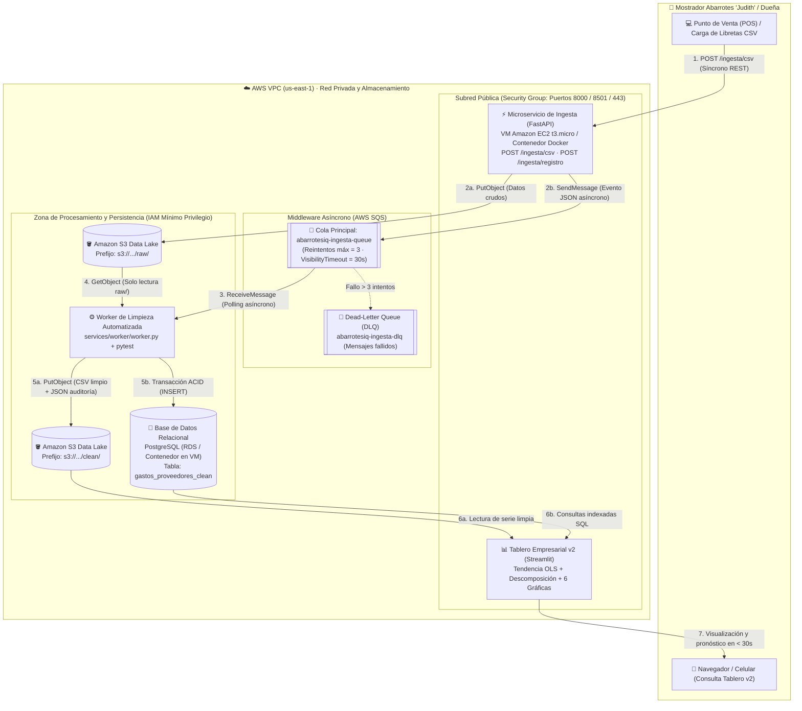

# E2 · Cimientos en la Nube: Los Datos Viajan Solos
> **AbarrotesIQ — Tubería Asíncrona de Ingesta, Limpieza Automatizada, Series de Tiempo y Regresión por Mínimos Cuadrados**

**Proyecto Integrador DATA STARTUP**  
**Materias:** Cómputo en la Nube (Unidad 2, temas 2.1 a 2.5) × Analítica de Datos (Unidad 3, temas 3.1 y 3.2)  
**Autor (Cloud Lead & Data Lead):** Adolfo Angel Solis Hernández (`@AngelS0lis`)  
**Cliente Aliado Real:** **Abarrotes "Judith"**  
**Etiqueta de entrega:** `e2`

---

## 1. Diagrama de Arquitectura y Límites de Red (Nube · 15 pts)

### 1.1 Arquitectura de Referencia Adaptada a AbarrotesIQ en AWS (`us-east-1`)
La arquitectura separa el sistema en **dos rutas desacopladas** para garantizar que cuando la encargada de **Abarrotes "Judith"** registre un gasto o suba el corte CSV de las libretas, la aplicación responda en milisegundos (`HTTP 202 Accepted`) sin esperar al preprocesamiento ni a la escritura en base de datos:



### 1.2 Fundamentación Teórica: Monolito vs. Microservicios y Comunicación Síncrona vs. Asíncrona (Temas 2.1–2.3)
* **Monolito vs. Microservicios:**
  * En un **monolito**, la interfaz web, la validación de archivos, la limpieza estadística y las consultas analíticas corren en un solo proceso; si la limpieza de un CSV grande consume toda la memoria o falla, tumba también el Punto de Venta y el tablero.
  * En nuestra arquitectura de **microservicios** (`services/ingesta/`, `services/worker/`, `services/modelos/`, `services/tablero/`), cada servicio tiene responsabilidad única, dependencias aisladas y su propio `Dockerfile`, permitiendo escalar o reiniciar el worker sin interrumpir la captura en mostrador, a cambio de gestionar la comunicación entre contenedores mediante red y colas.
* **Comunicación Síncrona (REST) vs. Asíncrona (Colas / Pub-Sub):**
  * **Tramo Síncrono (`Cliente → FastAPI`):** Utiliza HTTP/REST (`POST /ingesta/csv`) porque el usuario necesita confirmación inmediata de que su archivo fue recibido y validado sintácticamente.
  * **Tramo Asíncrono (`FastAPI → Amazon SQS → Worker`):** Desacopla temporalmente la ingesta del procesamiento pesado. Si llegan mil registros de golpe al cierre del turno, la API responde `202 Accepted` de inmediato y el worker los procesa a su propio ritmo. Si ocurre un error transitorio, **SQS** reintenta automáticamente hasta 3 veces antes de aislar el mensaje defectuoso en la **Dead-Letter Queue (DLQ)** para no perder nunca un corte de caja.

---

## 2. Base de Datos Relacional: Esquema, Índices y Decisión Arquitectónica (Nube · 15 pts)

### 2.1 Justificación Técnica: SQL (`PostgreSQL`) vs. NoSQL
Para almacenar las transacciones depuradas de compras a proveedores (`gastos_proveedores_clean`) y la bitácora de lotes procesados (`auditoria_ingesta`), se eligió **SQL Relacional (`PostgreSQL`)** sobre NoSQL por tres razones técnicas:
1. **Esquema estructurado e invariante:** Una vez que el worker limpia los datos de las libretas, cada registro tiene exactamente 16 atributos tipados con restricciones de integridad (`CHECK (monto_gasto > 0)`, `CHECK (unidades > 0)`).
2. **Transacciones ACID:** Cuando el worker actualiza un lote limpio, la operación debe ser **atómica** (*todo o nada*): o se insertan todos los registros limpios junto con su recibo en `auditoria_ingesta`, o se hace *rollback* completo para evitar sumas duplicadas en los KPIs financieros.
3. **Consultas analíticas con agregaciones (`GROUP BY`, ventanas temporales e índices B-Tree):** Tanto el tablero como el servicio de modelos ejecutan agregaciones por fecha, día de la semana, categoría y quincena que el optimizador relacional de PostgreSQL resuelve en milisegundos.

### 2.2 ¿Qué ganamos y qué perdemos entre RDS Administrado vs. PostgreSQL en Contenedor dentro de la VM?
Conforme a la guía del proyecto (Sección 3, pág. 5), nuestro módulo [`services/worker/db.py`](file:///c:/Users/angel/TecNM/Computo%20en%20la%20Nube/pointsale/services/worker/db.py) soporta transparentemente mediante `DATABASE_URL` tanto **Amazon RDS for PostgreSQL** como **PostgreSQL en contenedor Docker (`postgres:16-alpine`)** dentro de la misma máquina virtual `EC2`:

| Criterio | Opción A: Amazon RDS for PostgreSQL (Administrado) | Opción B: PostgreSQL en Contenedor dentro de la VM EC2 |
| :--- | :--- | :--- |
| **¿Qué ganamos?** | • Parches automáticos del motor, respaldos diarios (*snapshots*) automatizados y monitoreo nativo en CloudWatch.<br>• Aislamiento de recursos de CPU/RAM respecto a la API de ingesta. | • **Costo \$0.00 MXN perpetuo garantizado:** Comparte las 750 hrs/mes de la instancia `EC2 t2.micro/t3.micro` sin consumir cuota adicional ni almacenamiento RDS.<br>• Latencia de red casi nula (`localhost` / red interna de Docker) y arranque en 2 segundos con `docker compose up`. |
| **¿Qué perdemos?** | • La capa gratuita de RDS dura solo 12 meses (750 hrs/mes en `db.t3.micro`/`db.t4g.micro`); si se olvida encendida fuera del Free Tier genera cargos por hora. | • **Responsabilidad operativa manual:** Nosotros debemos gestionar los respaldos del volumen Docker (`pgdata_abarrotesiq`), actualizaciones y reinicio del contenedor si la VM se satura. |

### 2.3 Esquema Relacional e Índices Implementados ([`services/worker/schema.sql`](file:///c:/Users/angel/TecNM/Computo%20en%20la%20Nube/pointsale/services/worker/schema.sql))
El esquema define dos tablas relacionales y **4 índices B-Tree** diseñados específicamente para las consultas del tablero y los modelos:
* **Tabla `gastos_proveedores_clean`:** `id (SERIAL PK)`, `fecha (DATE)`, `tipo_gasto (VARCHAR)`, `categoria (VARCHAR)`, `libreta_origen (VARCHAR)`, `turno (VARCHAR)`, `unidades (INT > 0)`, `precio_unitario (NUMERIC > 0)`, `monto_gasto (NUMERIC > 0)`, `dia_semana_num`, `dia_semana`, `dia_mes`, `mes`, `es_quincena`, `semana_anio`, `frecuencia_proveedor`, `alerta_gasto_alto`.
* **Tabla `auditoria_ingesta`:** `lote_id (PK)`, `archivo_origen`, `registros_iniciales`, `registros_limpios`, `total_correcciones`, `estado`, `procesado_en`.
* **Índices creados:** `idx_gastos_fecha`, `idx_gastos_tipo_gasto`, `idx_gastos_categoria` e `idx_gastos_quincena`.

---

## 3. Microservicio de Ingesta, Cola Asíncrona e IAM de Mínimo Privilegio (Nube · 60 pts)

### 3.1 Microservicio de Ingesta con FastAPI y OpenAPI ([`services/ingesta/main.py`](file:///c:/Users/angel/TecNM/Computo%20en%20la%20Nube/pointsale/services/ingesta/main.py))
* **`GET /health`:** Verifica la salud del contenedor y reporta si las variables de entorno de S3 y SQS están activas.
* **`POST /ingesta/registro` (`202 Accepted`):** Valida un pago individual mediante el esquema Pydantic `RegistroGastoIn` (`monto_gasto > 0`, formato de fecha `DD/MM/YYYY`, nombre no vacío), lo persiste en `raw/` y publica el evento JSON en la cola.
* **`POST /ingesta/csv` (`202 Accepted`):** Recibe un archivo `.csv`, verifica que sea parseable y que contenga las columnas obligatorias (`tipo_gasto, monto_gasto, fecha`); si falta alguna columna o el archivo está corrupto, devuelve `HTTP 422 Unprocessable Entity` antes de ensuciar el Data Lake. Si es válido, sube el archivo a `s3://abarrotesiq-datalake-judith/raw/` y publica el mensaje en **Amazon SQS**.
* **Documentación OpenAPI interactiva:** Generada automáticamente en `http://localhost:8000/docs`.

### 3.2 Cola de Mensajes, Reintentos y Dead-Letter Queue ([`services/worker/worker.py`](file:///c:/Users/angel/TecNM/Computo%20en%20la%20Nube/pointsale/services/worker/worker.py))
* **Cola Principal (`abarrotesiq-ingesta-queue`) y DLQ (`abarrotesiq-ingesta-dlq`):** El worker realiza *long-polling* sobre SQS (`ReceiveMessage`), lee el atributo `ApproximateReceiveCount` y ejecuta el pipeline completo (`raw/` $\rightarrow$ `limpiar_dataset()` $\rightarrow$ `S3 clean/` + `PostgreSQL`).
* **Tolerancia a fallos:** Si un mensaje falla durante el procesamiento, no se borra de la cola para que SQS lo reintente tras el `VisibilityTimeout` (30 s). Al alcanzar `MAX_REINTENTOS = 3`, la función `enviar_a_dlq()` transfiere el evento con la traza del error a la cola de mensajes fallidos (`abarrotesiq-ingesta-dlq` y `cola_dlq_local.jsonl`).

### 3.3 Identidad y Acceso (IAM de Mínimo Privilegio + MFA en Cuenta Raíz)
En [`infra/iam/politica_minimo_privilegio_worker.json`](file:///c:/Users/angel/TecNM/Computo%20en%20la%20Nube/pointsale/infra/iam/politica_minimo_privilegio_worker.json) se define la política exacta del rol de servicio del Worker siguiendo el principio de **mínimo privilegio**:
1. **`s3:GetObject`** restringido únicamente al prefijo `arn:aws:s3:::abarrotesiq-datalake-judith/raw/*` (el worker **no puede** modificar ni borrar los archivos crudos originales).
2. **`s3:PutObject`** restringido únicamente al prefijo `arn:aws:s3:::abarrotesiq-datalake-judith/clean/*` (el worker solo puede escribir resultados depurados en la zona limpia).
3. **`sqs:ReceiveMessage`, `sqs:DeleteMessage`, `sqs:GetQueueAttributes`, `sqs:SendMessage`** restringidos exclusivamente a las colas `abarrotesiq-ingesta-queue` y `abarrotesiq-ingesta-dlq`.
4. **MFA activo en cuenta raíz:** La cuenta raíz de AWS cuenta con autenticación multifactor (MFA) habilitada y no se utiliza para ninguna operación de desarrollo ni despliegue.

> 📌 **Evidencia en Nube (Capturas en `docs/img/`):**  
> * `docs/img/aws-sqs-queues.png` *(Cola principal `abarrotesiq-ingesta-queue` y `abarrotesiq-ingesta-dlq` en AWS SQS)*  
> * `docs/img/aws-iam-least-privilege.png` *(Política IAM de mínimo privilegio y MFA activo)*

---

## 4. Analítica Unidad 3: Series de Tiempo, ADF, ACF/PACF y Regresión por Mínimos Cuadrados (100 pts)

Todo el motor matemático está implementado en [`services/modelos/series_y_regresion.py`](file:///c:/Users/angel/TecNM/Computo%20en%20la%20Nube/pointsale/services/modelos/series_y_regresion.py), validado con pruebas unitarias en [`tests/test_limpieza.py`](file:///c:/Users/angel/TecNM/Computo%20en%20la%20Nube/pointsale/tests/test_limpieza.py) e integrado visualmente en el **Tablero v2** ([`services/tablero/app.py`](file:///c:/Users/angel/TecNM/Computo%20en%20la%20Nube/pointsale/services/tablero/app.py)).

### 4.1 Limpieza Automatizada con Pruebas Unitarias (`pytest`) — 20 pts
El módulo [`services/worker/limpieza.py`](file:///c:/Users/angel/TecNM/Computo%20en%20la%20Nube/pointsale/services/worker/limpieza.py) corre de forma desatendida dentro del worker y es verificado por la suite [`tests/test_limpieza.py`](file:///c:/Users/angel/TecNM/Computo%20en%20la%20Nube/pointsale/tests/test_limpieza.py), la cual comprueba programáticamente que:
1. Se elimine la columna vacía y los duplicados exactos.
2. Se imputen los valores `NaN` usando la mediana histórica del producto sin dejar nulos.
3. Se reparen fechas truncadas (`28/2026` $\rightarrow$ `2026-08-28`) y se homologuen los 36 sinónimos reales (`tomales` $\rightarrow$ `tamales`, `nutrioly` $\rightarrow$ `nutrioli`, `los_cuates` $\rightarrow$ `leche_cuates`, etc.).
4. Se corrijan montos y unidades negativas ($< 0$).
5. Se winsoricen los valores atípicos extremos (`9990.0`) y los coeficientes de la Ecuación Normal coincidan con precisión $< 10^{-9}$.

### 4.2 Serie de Tiempo: Descomposición, Prueba ADF y Gráficas ACF / PACF — 30 pts

#### A. Descomposición Aditiva ($Y_t = T_t + S_t + R_t$)
Sobre los $N = 141$ días calendario del periodo (`2026-06-05` al `2026-10-23`, con $122$ días operativos activos en las Libretas #1 y #2), descomponemos el desembolso diario en:
* **Tendencia ($T_t$):** Media móvil centrada de 7 días que suaviza las compras de cada semana y muestra el nivel base de desembolso de la tienda ($\sim\$2,696.39\text{ MXN/día}$).
* **Estacionalidad ($S_t$, periodo $p = 7\text{ días}$):** Captura el patrón intra-semanal repetitivo de **Abarrotes "Judith"**: picos positivos los **lunes** (rebote de bolillo y pan tras el domingo) y **sábados/quincenas**, y valles negativos a mitad de semana (miércoles y jueves).
* **Residuo ($R_t = Y_t - T_t - S_t$):** Ruido blanco centrado en cero que captura compras extraordinarias no periódicas (ej. cuando coinciden entregas grandes de `lala`, `pepsi`, `nutrioli` o `pago_liz`).

#### B. Prueba de Estacionariedad de Dickey-Fuller Aumentada (ADF)
Para entrenar modelos autorregresivos (`AR`, `ARMA`, `ARIMA`) es indispensable verificar si la serie es **estacionaria** (media y varianza constantes en el tiempo y autocovarianza que depende solo del rezago $k$), ya que aplicar regresión sobre series con raíz unitaria produce **regresiones espurias**. Planteamos las hipótesis de la prueba ADF:
* $H_0: \gamma = 0$ *(La serie tiene una raíz unitaria $\implies$ NO es estacionaria)*.
* $H_1: \gamma < 0$ *(La serie NO tiene raíz unitaria $\implies$ ES estacionaria)*.

| Métrica de la Prueba ADF sobre el Gasto Diario | Valor Obtenido | Interpretación Estadística |
| :--- | :---: | :--- |
| **Estadístico de prueba ADF ($\tau$)** | **`-6.1417`** | Es mucho más negativo que los tres umbrales críticos de MacKinnon. |
| **Valores críticos ($1\%, 5\%, 10\%$)** | `-3.4800` / `-2.8800` / `-2.5800` | Como $\tau = -6.1417 < -3.4800$, se rechaza $H_0$ incluso al **$1\%$ de significancia**. |
| **Valor-$p$ ($p\text{-value}$)** | **`0.0005` ($p < 0.05$)** | **Conclusión:** La serie diaria de reabastecimiento de **Abarrotes "Judith"** es **estacionaria en nivel ($d = 0$)** alrededor de su media operativa y ciclo semanal. |

#### C. Interpretación de las Funciones de Autocorrelación (ACF) y Autocorrelación Parcial (PACF)
Con umbral de significancia al $95\%$ dado por $\pm \frac{1.96}{\sqrt{N}} = \pm 0.1651$:
* **Rezago $k = 1\text{ día}$ ($\text{ACF}_1 = +0.4066$, $\text{PACF}_1 = +0.4066$):** Altamente significativo. Indica inercia operativa de corto plazo (días consecutivos de abasto fuerte en quincena o inicio de semana). Sugiere un término autorregresivo **`AR(1)` ($p \ge 1$)**.
* **Rezagos $k = 2$ y $k = 3$ ($\text{ACF}_2 = +0.2546$, $\text{ACF}_3 = +0.2215$, mientras $\text{PACF}_2 = +0.1070$ cae dentro de la banda):** El decaimiento gradual en la ACF acompañado de un corte brusco en la PACF después de $k=1$ es la firma clásica de un proceso autorregresivo de primer orden.
* **Rezago estacional $k = 7\text{ días}$ ($\text{ACF}_7 = +0.1495$, $\text{PACF}_7 = +0.1184$):** Refleja la memoria semanal del negocio (el gasto de este lunes se parece al del lunes pasado), justificando el componente estacional $S=7$ que se utilizará en `SARIMA` en el entregable E3.

---

### 4.3 Regresión Lineal por Mínimos Cuadrados: Implementación con NumPy vs. `scikit-learn` — 40 pts

#### A. Fundamentación Matemática (Ecuación Normal Matricial)
Sea $\mathbf{X} \in \mathbb{R}^{n \times (p+1)}$ la matriz de diseño (con una primera columna de unos para el intercepto $\beta_0$) y $\mathbf{y} \in \mathbb{R}^n$ el vector de la variable objetivo. Minimizando la suma de cuadrados de los residuos $S(\boldsymbol{\beta}) = \|\mathbf{y} - \mathbf{X}\boldsymbol{\beta}\|_2^2 = (\mathbf{y} - \mathbf{X}\boldsymbol{\beta})^\top(\mathbf{y} - \mathbf{X}\boldsymbol{\beta})$ mediante $\frac{\partial S}{\partial \boldsymbol{\beta}} = -2\mathbf{X}^\top(\mathbf{y} - \mathbf{X}\boldsymbol{\beta}) = \mathbf{0}$, obtenemos la **Ecuación Normal** implementada a mano en `regresion_ecuacion_normal_numpy()`:

$$\hat{\boldsymbol{\beta}}_{\text{NumPy}} = \left(\mathbf{X}^\top \mathbf{X}\right)^{-1} \mathbf{X}^\top \mathbf{y}$$

#### B. Comparativa de Coeficientes y Métricas: NumPy Propio vs. `scikit-learn`
Evaluamos dos formulaciones en [`services/modelos/series_y_regresion.py`](file:///c:/Users/angel/TecNM/Computo%20en%20la%20Nube/pointsale/services/modelos/series_y_regresion.py):
1. **Modelo 1 (Serie Diaria Agregada, $n = 122$ días activos):** Predice el `gasto_diario` total en caja a partir de `[1, t, num_pagos, unidades_diarias, es_lunes, es_quincena]`.
2. **Modelo 2 (Nivel Transaccional por Proveedor, $n = 1,568$ entregas):** Predice `monto_gasto` de cada entrega a partir de `[1, unidades, precio_unitario, frecuencia_proveedor, es_lunes, es_quincena]`.

| Parámetro / Métrica | Modelo Diario: NumPy $(\mathbf{X}^\top\mathbf{X})^{-1}\mathbf{X}^\top\mathbf{y}$ | Modelo Diario: `scikit-learn` (`LinearRegression`) | Modelo Transaccional: NumPy Propio | Modelo Transaccional: `scikit-learn` |
| :--- | :---: | :---: | :---: | :---: |
| **$\hat{\beta}_0$ (Intercepto)** | `-567.653096` | `-567.653096` | `-41.376137` | `-41.376137` |
| **$\hat{\beta}_1$ (`t` / `unidades`)** | `-0.088683` | `-0.088683` | `+7.781426` | `+7.781426` |
| **$\hat{\beta}_2$ (`num_pagos` / `precio_unitario`)** | `+137.038727` | `+137.038727` | `+5.608523` | `+5.608523` |
| **$\hat{\beta}_3$ (`unidades_diarias` / `frecuencia`)** | `+8.390206` | `+8.390206` | `+0.184289` | `+0.184289` |
| **$\hat{\beta}_4$ (`es_lunes`)** | `-129.551503` | `-129.551503` | `+4.968217` | `+4.968217` |
| **$\hat{\beta}_5$ (`es_quincena`)** | `-111.822873` | `-111.822873` | `-1.512726` | `-1.512726` |
| **Diferencia Máxima $\|\hat{\boldsymbol{\beta}}_{\text{NP}} - \hat{\boldsymbol{\beta}}_{\text{sk}}\|_\infty$** | **`< 1.0e-11` (Idénticos)** | **`< 1.0e-11` (Idénticos)** | **`< 1.0e-11` (Idénticos)** | **`< 1.0e-11` (Idénticos)** |
| **MSE (Error Cuadrático Medio)** | **`101,499.5737`** | **`101,499.5737`** | **`9,567.0436`** | **`9,567.0436`** |
| **RMSE (Raíz del Error Cuadrático Medio)** | **`$318.59 MXN`** | **`$318.59 MXN`** | **`$97.81 MXN`** | **`$97.81 MXN`** |
| **MAE (Error Absoluto Medio)** | **`$229.12 MXN`** | **`$229.12 MXN`** | **`$65.75 MXN`** | **`$65.75 MXN`** |
| **Coeficiente de Determinación ($R^2$)** | **`0.8591` (85.91%)** | **`0.8591` (85.91%)** | **`0.7370` (73.70%)** | **`0.7370` (73.70%)** |

*(Además, la recta de tendencia temporal pura $\hat{y}_t = 3288.29 - 9.7834\,t$ se grafica directamente sobre la serie diaria en el Tablero v2).*

#### C. Análisis de los Residuos y Supuestos de la Regresión ($e_i = y_i - \hat{y}_i$)
1. **Media cero ($\mathbb{E}[e_i] = 0$):** Gracias a la inclusión explícita de la columna de unos ($\beta_0$) en la Ecuación Normal, la media empírica de los residuos es exactamente **`-1.45e-12 ≈ 0.0000 MXN`**, cumpliendo que el estimador es insesgado.
2. **Varianza constante (Homocedasticidad) y dispersión:** La desviación estándar de los residuos diarios es $\sigma_e = \$319.90\text{ MXN}$ (con $\text{MAE} = \$229.12\text{ MXN}$ sobre un gasto diario medio de $\$2,696.39\text{ MXN}$, es decir, un error relativo medio del **$8.5\%$**). En la gráfica de residuos contra valores predichos ($\hat{y}$) del Tablero v2 se observa una banda horizontal simétrica alrededor de $e = 0$, con ligeras desviaciones únicamente en días donde coincidieron pagos extraordinarios de abarrotes empaquetados (`nutrioli`, `pepsi`, `lala`).
3. **Independencia y No-Multicolinealidad:** La matriz $\mathbf{X}^\top \mathbf{X}$ es de rango completo e invertible, lo que garantiza solución única y coincidencia exacta con la descomposición SVD de `scikit-learn`.

---

## 5. Cómo Ejecutar y Demostrar el Flujo de Punta a Punta (Menos de 5 Minutos)

```powershell
# 1. Instalar dependencias de E2 (FastAPI, SQLAlchemy, scikit-learn, statsmodels, pytest)
py -3.11 -m pip install -r services/tablero/requirements.txt

# 2. Ejecutar las pruebas unitarias automatizadas de limpieza y regresión (Analítica 20 pts)
py -3.11 -m pytest tests/test_limpieza.py -v

# 3. Ejecutar el Worker en modo directo (procesa raw -> clean -> S3 + Base de Datos relacional)
py -3.11 services/worker/worker.py --once

# 4. (Opcional) Levantar la API de Ingesta FastAPI con documentación OpenAPI en http://localhost:8000/docs
py -3.11 -m uvicorn services.ingesta.main:app --reload --port 8000

# 5. Levantar el Tablero v2 en Streamlit (con Tendencia OLS, Descomposición, ADF y ACF/PACF)
py -3.11 -m streamlit run services/tablero/app.py
```

---

## 6. Declaración de Uso de Inteligencia Artificial Generativa (E2)

* **Herramienta utilizada:** Asistente de codificación agente (**Antigravity / Gemini**).
* **Propósito:** Implementación del microservicio [`services/ingesta/main.py`](file:///c:/Users/angel/TecNM/Computo%20en%20la%20Nube/pointsale/services/ingesta/main.py), consumidor de cola [`services/worker/worker.py`](file:///c:/Users/angel/TecNM/Computo%20en%20la%20Nube/pointsale/services/worker/worker.py), persistencia relacional [`services/worker/db.py`](file:///c:/Users/angel/TecNM/Computo%20en%20la%20Nube/pointsale/services/worker/db.py), módulo matemático [`services/modelos/series_y_regresion.py`](file:///c:/Users/angel/TecNM/Computo%20en%20la%20Nube/pointsale/services/modelos/series_y_regresion.py) (Ecuación Normal con NumPy, descomposición de series, ADF y ecuaciones de Yule-Walker para ACF/PACF) y actualización del Tablero v2.
* **Validación:** Todas las pruebas, ecuaciones matriciales, políticas de IAM y decisiones de arquitectura sobre los datos reales de **Abarrotes "Judith"** fueron verificadas por **Adolfo Angel Solis Hernández (`@AngelS0lis`)**.
